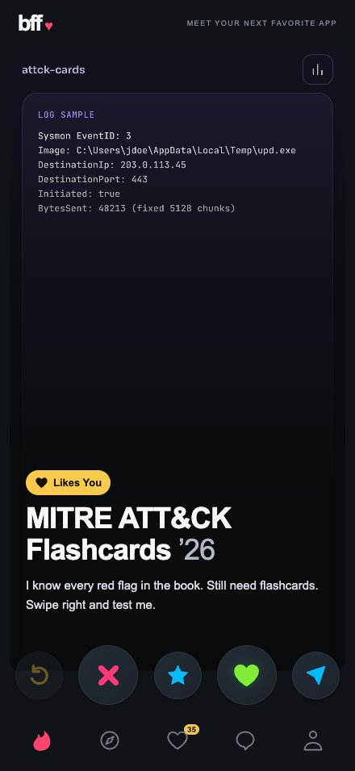
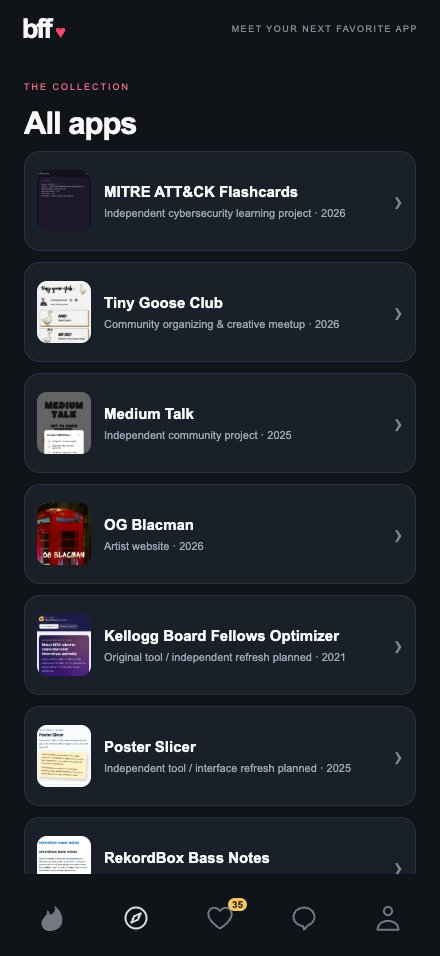
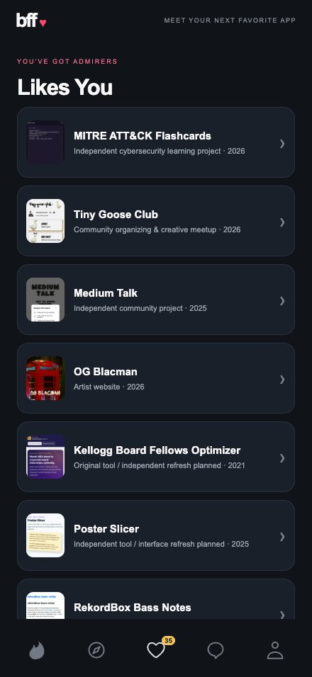
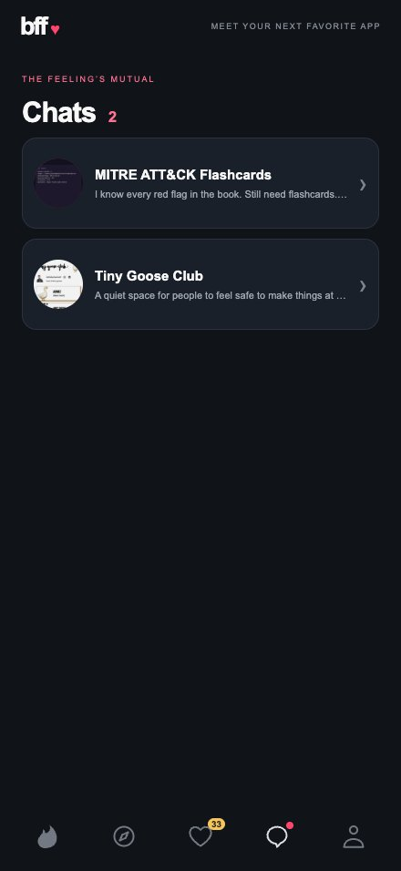
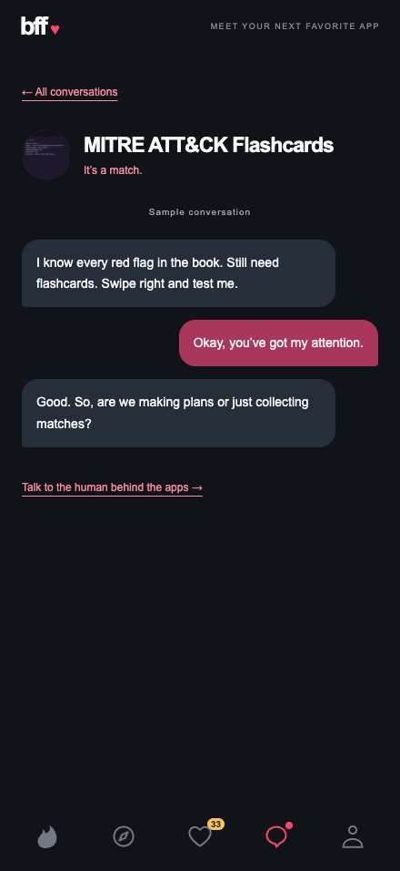
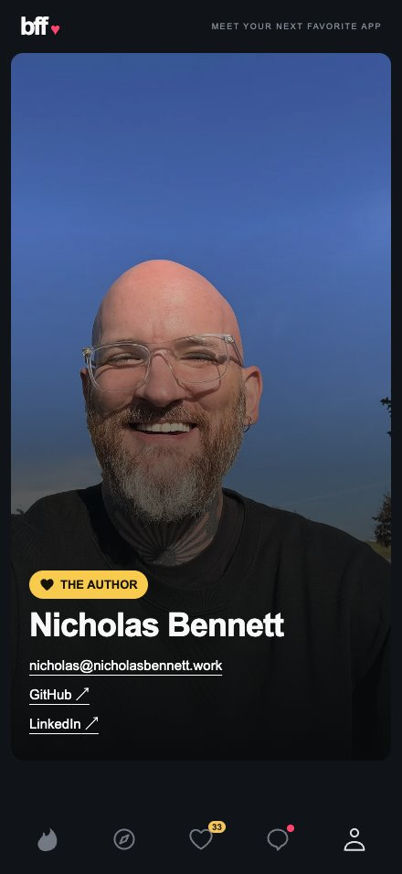
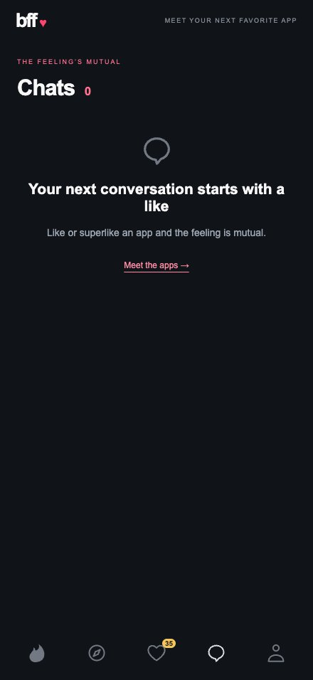
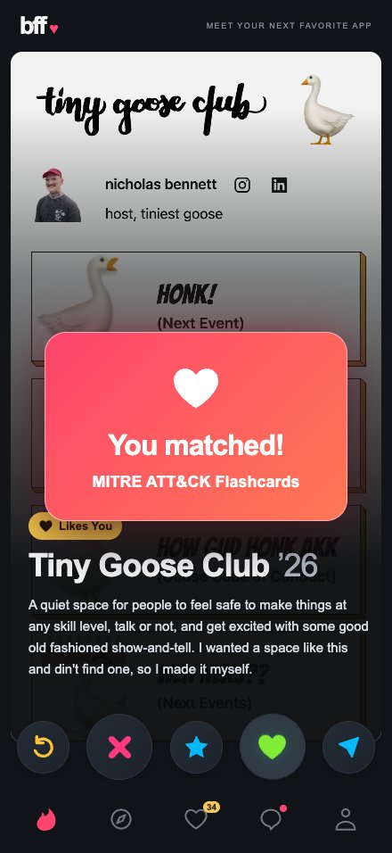

# BFF portfolio

A mobile-first portfolio that borrows the language of a dating app: browse projects, swipe on the ones you like, and turn those likes into sample conversations. Built with React and Vite, with 35 sample projects in `content.json`.

The five bottom navigation buttons open Home, Browser, Likes You, Chats, and Profile. They work on mobile and desktop, with hash routes and browser Back/Forward support.

## Customize a clone

Edit **[`content.json`](content.json)**. It is the single source for the site’s personalized links, text, image references, and dataset; you do not need to edit React components or `index.html`.

| Section | What to replace |
| --- | --- |
| `site` | Wordmark, tagline, browser/social title, description, language, theme color, canonical URL, and social image URL, alt text, and dimensions. Use absolute HTTPS URLs for the canonical URL and social image. |
| `owner` | Your name, email, contact links, and `photo` (`src`, `alt`, `width`, `height`). Use `""` for no email and `[]` for no contact links. |
| `copy` | Page and navigation labels, action labels, empty states, sample conversation replies, accessible descriptions, and status announcements. Keep the existing keys. |
| `projects` | Replace the sample array with your projects or other items. Array order is the initial swipe order. An empty array is supported. |

Each item needs a name, description, and unique URL-safe `slug` (letters, numbers, hyphens, underscores, or dots). Existing entries without a slug use the GitHub repository name as their ID. An example item looks like this:

```json
{
  "slug": "my-project",
  "name": "My project",
  "description": "A short introduction to this item.",
  "label": "Creative tool",
  "websiteUrl": "https://example.com/",
  "githubUrl": "https://github.com/example/my-project",
  "firstCommitDate": "2026-01-01T00:00:00Z",
  "image": "/project-screenshots/my-project.jpg"
}
```

`label`, URLs, date, and image are optional. Missing dates hide the age; missing URLs disable the corresponding external action. Set `image` to `null` or omit it for a labeled placeholder. Images can be local paths starting with `/` or absolute HTTPS URLs. For another kind of dataset, rename the app-specific wording in `copy`, including the image description and external-action descriptions.

Put local image files in `public/` and reference them without the `public` prefix: `public/avatar.jpg` becomes `/avatar.jpg`. Update the profile photo’s alt text and dimensions, and replace the social-preview image itself when changing the branding. The existing `media` arrays are supporting context from the sample dataset; the rendered card uses `image`.

`npm run screenshot` writes each selected project’s `image` and generated `capture` details back to `content.json`. You can omit `capture` when supplying your own images. The optional `screenshotDismissButton` holds the accessible name of an onboarding button to dismiss before capture. Review and commit the resulting content and image changes together.

Vite fills the HTML metadata from `site` in development and at build time, so social crawlers receive it without running JavaScript. Rebuild after changing content for production. Everything in this file ships to the browser; keep credentials and private information out of it. Hosting accounts, domains, and deployment connections must be configured for your own clone.

## How the app flows

1. **Meet an app on Home.** Each card shows a captured project homepage, its name, a short bio, and an “age” such as `’26`, taken from the project’s first commit year.
2. **Swipe or use the buttons.** Swipe left to pass or right to like. On desktop, click and drag anywhere on the card above the buttons. The card rotates and exits to the side, revealing the blurred next card underneath. A short drag snaps back; vertical gestures scroll long bios.
3. **Make a match.** Every app has already liked you, so a Like or Superlike always matches. A “You matched!” popup zooms in over 0.25 seconds, stays for 1.5 seconds, then zooms out over 0.25 seconds. The app leaves the swipe stack and Likes You, and appears in Chats.
4. **Open a conversation.** Chats lists each matched app once. Tapping one opens a playful sample thread based on its bio. The chat icon gets a red dot whenever at least one match exists; opening Chats does not clear it.
5. **Meet the author.** Follow the thread’s author link or tap Profile to see the configured author card and contact links. This card stays fixed and cannot be swiped away.

Browser provides another entry point: select any project to preview its card on Home, including an existing match. Likes You lists only apps you have not decided on; its badge shows that list’s actual size, including zero. Passing an app removes it from Likes You but puts it at the back of the swipe queue, so it returns after the other queued apps.

| Card control | Result |
| --- | --- |
| Undo | Restore the previous decision and exact queue order; clear the match popup. |
| Pass / swipe left | Move the app to the back of the queue. If it was matched, remove its conversation. |
| Superlike | Match and open the project website in a new tab. Disabled when no public website is supplied. |
| Like / swipe right | Match and move the app into Chats. |
| Share | Open the project’s GitHub repository in a new tab without changing the decision. |

Decisions persist while navigating, then reset on reload. Chats are canned examples, with no message composer, live messaging, account, or backend. An unavailable thread falls back to the Chats list. Matching every app shows the empty deck and a link to Chats; Undo can bring the last card back.

## Pages and screenshots

These are actual Playwright captures at the iPhone 16 Pro Max’s 440 × 956 CSS-pixel screen size. Home, Browser, Likes You, and empty Chats show a fresh session; the populated Chats, thread, and Profile captures show the same session after two matches. Click an image to open the full capture.

| Home · `#home` | Browser · `#browser` |
| --- | --- |
| <a href="docs/screenshots/home.jpg"></a> | <a href="docs/screenshots/browser.jpg"></a> |
| The swipe deck, with Undo, Pass, Superlike, Like, and Share controls. | The complete project list. Select a row to bring its card to Home. |

| Likes You · `#likes` | Chats · `#chats` |
| --- | --- |
| <a href="docs/screenshots/likes.jpg"></a> | <a href="docs/screenshots/chats.jpg"></a> |
| Apps awaiting your decision. Matches leave this list and reduce the badge count. | Matched apps become conversations. Open a row to read its sample thread. |

| Sample conversation · `#chats/<app-id>` | Profile · `#profile` |
| --- | --- |
| <a href="docs/screenshots/chat-thread.jpg"></a> | <a href="docs/screenshots/profile.jpg"></a> |
| Three sample messages, a link back to Chats, and a link to the author’s profile. | A single photo and contact links, with the text lowered to leave the face clear. |

| Before the first match | Match celebration |
| --- | --- |
| <a href="docs/screenshots/chats-empty.jpg"></a> | <a href="docs/screenshots/match.jpg"></a> |
| Chats points visitors back to the deck until they make a match. | The popup dismisses automatically and does not block swiping or navigation. |

### Refresh the page screenshots

Start the dev server, then run the following in another terminal, adjusting `TEST_URL` to its printed address:

```sh
TEST_URL=http://127.0.0.1:5173 npm run screenshot:pages
```

The script in `scripts/screenshot-pages.mjs` creates a fresh session, captures the five main pages, opens a sample thread, and captures empty Chats and the match popup. It checks the project count, match count, likes badge, chat dot, and browser errors while capturing. The eight JPEGs live in `docs/screenshots/`; they use CSS-pixel resolution to keep the README assets small. The script uses the installed Playwright Chromium browser; install it with `npx playwright install chromium` if needed.

## Run locally

Use Node.js 20.19+ or 22.12+; Node 21 is unsupported.

```sh
npm install
npm run dev
```

Open the URL printed by Vite, normally `http://127.0.0.1:5173`. Run `npm run build` to create `dist/`, then `npm run preview` to preview the production build.

## Vercel deployment

Import your cloned repository into your own Vercel account. Use the Vite framework preset, `npm run build`, and the `dist` output directory. Configure your domain there and set `site.url` and `site.image` in `content.json` to its public URLs.

`.vercelignore` excludes original author photos, local build output, README screenshots, and local Vercel metadata from CLI uploads. The published app uses the optimized images in `public/`.

## Code and data

| File | Responsibility |
| --- | --- |
| `src/main.jsx` | React entry point. |
| `src/App.jsx` | The five views, matching popup, badges, conversations, and contact links. |
| `src/Swiper.jsx` | Pointer gestures, card rotation, card exits, and action controls. |
| `src/actions.js` | Ordered swipe queue, reactions, match history, and Undo. |
| `src/navigation.js` | Hash routes and browser history subscriptions. |
| `src/AuthorCard.jsx` | The fixed personal profile card. |
| `content.json` | Site metadata, branding, author details, UI copy, projects, image references, and capture results. |
| `src/data.js` | Content exports and derived project IDs, years, initials, themes, and fallback labels. |
| `vite.config.js` | Inserts configured metadata into the HTML document before serving or building. |
| `icons.svg` / `styles.css` | Shared SVG symbols and responsive presentation. |

Project descriptions appear as card bios; longer `problem`, `role`, and related fields remain in the source data. Project “ages” use the last two digits of `firstCommitDate`, prefixed with an apostrophe.

Mobile fills the viewport with safe-area padding; desktop uses a centered phone layout. The viewport clips rotated cards so swipes cannot create scrollbars. Lists, threads, and long card bios scroll independently. Reduced-motion preferences skip card transitions and replace the popup’s zoom with a fade. Decisions are announced through a visually hidden status region; there is no visible status footer.

The author card serves the image configured in `owner.photo`. The included sample is an optimized 1320 × 1760 WebP at about 223 KB. Original camera files can be kept under the ignored `source-assets/author-photos/` directory; they are excluded from the website build.

## Icons

The app uses original, reusable SVG symbols in `icons.svg`, bundled by Vite. No icon package or CDN is required. The sprite also includes a hamburger menu symbol. Accessible labels belong on the enclosing control:

```html
<button aria-label="Undo">
  <svg aria-hidden="true"><use href="icons.svg#undo"></use></svg>
</button>
```

For an alternative library, the equivalent names in [Phosphor’s SVG catalog](https://github.com/phosphor-icons/core) are:

| Action | Phosphor name | Weight / color |
| --- | --- | --- |
| Undo | ArrowCounterClockwise | Bold / yellow |
| Pass | X | Bold / pink |
| Superlike | Star | Fill / blue |
| Like | Heart | Fill / green |
| Share | PaperPlaneTilt | Fill / blue |
| Home | Fire | Fill / pink |
| Browser | Compass | Regular / gray |
| Likes | Heart | Regular / gray |
| Chats | ChatCircle | Regular / gray |
| Profile | User | Regular / gray |

## Project homepage screenshots

The card images are separate from the README’s page captures. `public/project-screenshots/` contains 34 JPEGs captured from the supplied `websiteUrl` values, including documentation or package pages when those are the supplied destinations. Dancefloor Bass Analyzer has no public website URL and uses a labeled fallback. Lists use the same captures as thumbnails.

Project captures use the full 440 × 956 iPhone 16 Pro Max screen viewport at 3× pixel density, producing 1320 × 2868 images. Medium Talk’s onboarding tip is dismissed before capture. Each project’s `capture` record in `content.json` records success or failure; a failed capture uses a labeled fallback.

```sh
npm run screenshot
# Refresh a single project by slug or GitHub repository name:
npm run screenshot -- medium-talk
```

## Validation

```sh
npm test
npm run build
# With the dev server running; adjust the address if needed:
TEST_URL=http://127.0.0.1:5173 npm run test:e2e
```

Unit/render tests include a different owner and a sparse or empty dataset, generated HTML metadata, reaction history, queue order, Undo, routes, SVG references, external controls, contacts, the author card, and screenshot files. The Playwright scenarios expect a populated demo collection with at least three items, working sample external links, and the supplied screenshot dimensions. They check all views, live badges, popup timing, sample threads, external link destinations, and responsive layouts. They also exercise desktop dragging and emulated touch: rotation, blurred next cards, short/cancelled/vertical gestures, queue cycling, matched apps staying out, empty decks, Undo, reduced motion, clipped exits, and the fixed author card.

External destinations are stubbed during navigation tests. Visual QA images from those checks are written under `/private/tmp/`; the committed README captures are refreshed separately with `npm run screenshot:pages`.

Browser checks use Chromium mobile emulation. Physical iPhone Safari has not been tested. Reactions reset on reload, and sample conversations do not send messages.
